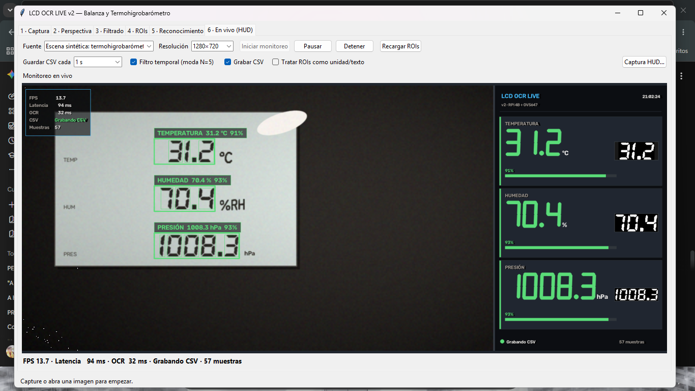

# LCD OCR LIVE v2 — Balanza y Termohigrobarómetro

OCR en tiempo real con **OpenCV (`cv2`) y NumPy puros** para leer el display de
una balanza (LCD) y de un termohigrobarómetro (7 segmentos) desde una
**Raspberry Pi 4B + cámara OV5647** o desde un PC con Windows/Linux.

Este proyecto es una evolución paralela del proyecto `lcd_ocr` original:
**no modifica ni sobrescribe nada** de aquel directorio; reutiliza sus
`datasets/`, `data/` y `assets/` y añade captura multi-backend, preprocesado
adaptativo, segmentación geométrica, reconocimiento triple y un HUD de
monitoreo continuo.



*Pestaña 6 con una escena sintética generada a partir de los glifos reales del
dataset: cajas semafóricas, banners por ROI, estadísticas y dashboard digital.*

---

## 1. Novedades frente a `lcd_ocr`

| Área | v1 | v2 |
|---|---|---|
| Cámara | Picamera2 únicamente | `CameraStream` con Picamera2, GStreamer/libcamera, V4L2, DirectShow y MSMF; hilo *bufferless* y control de exposición/ganancia |
| Preprocesado | Umbral manual/Otsu/adaptativo | CLAHE en luminancia, binarizado automático, limpieza de ruido y puenteo morfológico por perfil (LCD / 7 segmentos) |
| Segmentación | Contornos agrupados | Proyección vertical (agrupa los 7 segmentos aunque no se toquen), pre-clasificación geométrica, relleno negro del `1` y división de dígitos pegados por valle |
| Reconocimiento | Un método (template **o** KNN) | Fusión de `matchTemplate` (CCOEFF + SQDIFF), KNN (`cv2.ml` con respaldo numpy) y desempate topológico A–G |
| Estabilidad | Sin filtro | Cola circular de 5 lecturas y **moda**; descarta frames transitorios |
| Operación | Pestañas de calibración | + pestaña 6 de monitoreo en vivo, HUD con cajas semafóricas, banners, dashboard digital y CSV con intervalo |
| Lanzador | `main.py` | `main.py` + `main_live_hud.py` (ventana OpenCV, incluso headless) |
| Datos | `rois.json` básico | Compatible + `rol`/`unidad`, y `data/perspectiva.json` para rectificar el vídeo en vivo |

---

## 2. Estructura

```
lcd_ocr_live_v2/
├── config.py                  # parámetros de cámara, OCR, HUD y CSV
├── main.py                    # aplicación de escritorio (6 pestañas)
├── main_live_hud.py           # HUD directo en ventana OpenCV / headless
├── requirements.txt
├── assets/                    # capturas y HUD de verificación
├── docs/                      # captura de ejemplo del HUD
├── data/
│   ├── rois.json              # ROIs (compatible con el formato original)
│   ├── lecturas.csv           # registro histórico
│   └── perspectiva.json       # opcional: homografía guardada desde la pestaña 2
├── datasets/
│   ├── Balanza/               # digito_0..9, coma, punto, signo_menos
│   └── termohiglobarometro/   # dígitos, unidades y textos
├── core/
│   ├── camara.py              # CameraStream multi-backend + control de sensor
│   ├── preprocesado.py        # CLAHE, binarizado, puenteo, filtrado UI
│   ├── segmentacion.py        # proyección, geometría, división de pegados
│   ├── dataset.py             # plantillas canónicas 32×48 + aumentación
│   ├── siete_segmentos.py     # firmas A..G y desempate topológico
│   ├── reconocimiento.py      # fusión template + KNN + topología
│   ├── filtro_temporal.py     # moda de N frames por ROI
│   ├── instrumentos.py        # rol, unidad y composición de la lectura
│   ├── pipeline.py            # ROI → lectura completa
│   ├── roi.py                 # modelo ROI y JSON
│   ├── perspectiva.py         # homografía persistible y cacheada
│   ├── hud.py                 # HUD y dashboard dibujados con cv2
│   ├── monitor.py             # hilo de monitoreo + CSV + HUD
│   ├── simulador.py           # escenas sintéticas con los glifos reales
│   ├── log_lecturas.py        # CSV compatible
│   └── utils.py               # iluminación, imágenes, FPS, colores
├── ui/
│   ├── app.py                 # ventana y estado compartido
│   ├── widgets.py             # visor Tk (Pillow opcional / cv2)
│   ├── tab1_captura.py        # cámara, sensor día/noche, escena sintética
│   ├── tab2_perspectiva.py    # 4 esquinas + guardar homografía
│   ├── tab3_filtrado.py       # binarizado y CLAHE
│   ├── tab4_rois.py           # ROIs con instrumento, rol y unidad
│   ├── tab5_reconocimiento.py # OCR puntual + tabla de confianzas + CSV
│   └── tab6_live_hud.py       # monitoreo en vivo con HUD
├── tools/
│   └── verificar_instalacion.py
└── tests/
    └── test_pipeline.py
```

---

## 3. Instalación

### Raspberry Pi 4B (Raspberry Pi OS Bookworm)

```bash
sudo apt update
sudo apt install -y python3-opencv python3-numpy python3-picamera2 \
                    libcamera-apps python3-tk python3-pil \
                    gstreamer1.0-libcamera gstreamer1.0-plugins-good
cd lcd_ocr_live_v2
python3 -m venv .venv --system-site-packages   # Picamera2 viene de apt
source .venv/bin/activate
python tools/verificar_instalacion.py
```

> `--system-site-packages` es imprescindible: `picamera2` y `libcamera` no se
> instalan con `pip`.

Habilite la cámara y compruebe el sensor con la Raspberry apagada al conectar
el cable CSI:

```bash
rpicam-hello --list-cameras
rpicam-still -o prueba.jpg --width 1280 --height 720
```

### Windows / PC

```powershell
python -m venv .venv
.\.venv\Scripts\Activate.ps1
pip install -r requirements.txt
python tools\verificar_instalacion.py
```

`requirements.txt` incluye Pillow, que es **opcional**: solo acelera el volcado
del frame a Tk. El motor de visión usa exclusivamente `cv2` y `numpy`. La
aplicación funciona con OpenCV 4.x y 5.x: cuando `cv2.ml.KNearest` no existe
(OpenCV 5), se usa un KNN numpy equivalente y se informa en el log.

---

## 4. Uso

### 4.1 Calibración (una vez por montaje)

1. **Pestaña 1 · Captura** — inicie la cámara o abra una foto. Ajuste
   `Modo día` / `Modo noche (IR)` si ilumina con LED o infrarrojo. El botón
   `Escena sintética` genera un panel de prueba con los glifos del dataset.
2. **Pestaña 2 · Perspectiva** — marque las 4 esquinas del display en orden
   SI → SD → ID → II y pulse **Aplicar y guardar**. Se escribe
   `data/perspectiva.json`, que el monitoreo en vivo reutiliza.
3. **Pestaña 3 · Filtrado** — revise la binarización (CLAHE activo por
   defecto). El perfil `lcd` usa un puenteo suave; `7seg` uno vertical (3×5).
4. **Pestaña 4 · ROIs** — arrastre un rectángulo por cada campo. Indique
   `Instrumento`, `Rol` (Peso, Temperatura, Humedad, Presión, Unidad o Texto) y
   `Unidad` si desea forzarla. Guarde: `data/rois.json`.
   - Para una unidad o texto completo marque el rol `Unidad`/`Texto`.
   - Si no indica rol, se deduce del nombre (`temp`, `hum`, `pres`, `peso`…) y,
   en el termohigrobarómetro, del orden de las ROIs.
5. **Pestaña 5 · Reconocimiento** — OCR puntual con tabla de confianza por
   carácter y registro opcional en `data/lecturas.csv`.
6. **Pestaña 6 · En vivo (HUD)** — elija fuente (cámara, escena sintética o
   imagen actual), intervalo de CSV y filtro temporal; pulse **Iniciar
   monitoreo**.

### 4.2 Monitoreo continuo sin Tkinter

```bash
# Cámara CSI con la homografía guardada y HUD a escala 0.8
python main_live_hud.py --fuente camara --escala 0.8

# Demostración sin hardware (genera escenas y ROIs automáticamente)
python main_live_hud.py --fuente sintetica:termohigrobarometro
python main_live_hud.py --fuente sintetica:Balanza

# Por SSH, sin ventana: imprime lecturas cada 2 s
python main_live_hud.py --headless --intervalo 5s
```

Teclas en la ventana OpenCV: `q`/`ESC` salir, `espacio` pausar, `t` filtro
temporal, `g` CSV, `1`–`5` intervalo (tiempo real / 1 / 5 / 10 / 60 s),
`p` guardar una captura del HUD en `assets/capturas/`.

Opciones útiles: `--resolucion 960x720`, `--backend v4l2|picamera2|gstreamer`,
`--sin-perspectiva`, `--sin-guardar`, `--sin-filtro`, `--pantalla-completa`.

---

## 5. Cómo funciona el motor

### 5.1 Captura (`core/camara.py`)

- **Linux**: intenta Picamera2 (libcamera) → GStreamer `libcamerasrc` → V4L2.
- **Windows**: DirectShow → Media Foundation → backend automático.
- `CAP_PROP_BUFFERSIZE = 1` y un hilo dedicado con `grab()/retrieve()` que
  conserva solo el frame más reciente: la interfaz nunca acumula latencia.
- Resolución de trabajo por defecto **1280×720 a 30 FPS** (alternativa
  960×720). En la Pi 4B es el equilibrio entre nitidez de segmentos y CPU.
- Control de sensor (si el driver lo permite): exposición manual/automática,
  brillo, contraste y ganancia, con lectura de vuelta para detectar drivers que
  ignoran los ajustes. `modo_nocturno(True)` baja la exposición, sube el
  contraste y la ganancia para iluminación LED/IR.

### 5.2 Preprocesado (`core/preprocesado.py`)

1. **CLAHE** `clipLimit=2.0`, `tileGridSize=(8,8)` sobre luminancia (canal L en
   color) para compensar reflejos en el acrílico y viñeteo de la lente.
2. **Binarizado automático**: Otsu salvo que el histograma sea poco bimodal o
   el contraste bajo; entonces umbral adaptativo gaussiano. La polaridad se
   deduce del borde y puede forzarse.
3. **Limpieza de motas** por área mínima.
4. **Puenteo morfológico** `MORPH_CLOSE` con elipse `(3,5)` para 7 segmentos y
   `(2,3)` para LCD.

### 5.3 Segmentación (`core/segmentacion.py`)

- **Proyección vertical**: en un display de 7 segmentos cada dígito ocupa
  todas sus columnas (las barras A/D/G cruzan el ancho), así que los huecos
  entre dígitos son columnas sin tinta. Esto agrupa los 7 segmentos aunque no
  se toquen, sin fundir dígitos vecinos.
- **Puntuación**: un intervalo bajo, compacto y pegado a la base se clasifica
  como coma/punto. Un signo menos es bajo pero ancho (`AR > 1.7`).
- **Dígito `1`**: se conserva su proporción; si `AR < 0.38` se añade relleno
  negro lateral con `cv2.copyMakeBorder` antes de escalar, de modo que un `1`
  nunca se convierte en una barra blanca que parezca `0` u `8`.
- **Dígitos pegados**: si un bloque es ancho (`AR > 0.95`) y alto, se divide
  por el valle de `np.sum(roi_bin, axis=0)` en el número de cifras esperado.

### 5.4 Reconocimiento (`core/dataset.py`, `core/reconocimiento.py`)

Las plantillas del dataset se normalizan a **32×48** con la misma función que
los recortes en vivo: Otsu, polaridad, limpieza, relleno del `1`, escalado con
proporción y puenteo. Al arrancar se generan variantes desplazadas, erosionadas
y dilatadas en memoria (aumentación sintética).

Cada recorte se clasifica combinando:

1. `cv2.matchTemplate` con `TM_CCOEFF_NORMED` y `TM_SQDIFF_NORMED`
   (puntaje `0.6·ccoeff + 0.4·(1-sqdiff)`).
2. `cv2.ml.KNearest_create()` entrenado al vuelo con las variantes; puntaje por
   etiqueta según la muestra más cercana, con escala derivada de las distancias
   entre clases del propio dataset. Si el build de OpenCV no trae `cv2.ml`
   (OpenCV 5), se usa el mismo cálculo en numpy.
3. **Topología A–G**: se mide la densidad de tinta en las siete regiones y se
   compara con las firmas reales de las plantillas. Para los pares ambiguos se
   usan los segmentos que de verdad los separan:
   - `G` distingue `0` de `8`,
   - `B` distingue `6` de `8` y `5` de `9`,
   - `E` (y `C` cuando hace falta) distingue `9` de `8` y `3` de `2`.

Los pesos de fusión están en `config.PESOS_FUSION` (0.50 plantilla, 0.30 KNN,
0.20 topología en 7 segmentos; la topología baja al 12 % en LCD).

### 5.5 Filtro temporal y semántica

- `core/filtro_temporal.py`: cola circular de 5 lecturas por ROI; se publica la
  **moda** y se descartan valores con `?`. La lectura se marca como estable a
  partir de 3 coincidencias.
- `core/instrumentos.py`: compone el texto, convierte coma/punto decimal,
  asigna rol y unidad. `ROLES`/`UNIDAD_POR_ROL` en `config.py`.

---

## 6. HUD y dashboard

Dibujado íntegramente con `cv2`:

- Caja de cada ROI con color semafórico: **verde ≥ 80 %**, **amarillo 60–79 %**,
  **rojo < 60 %**, más esquinas técnicas.
- Sub-caja de cada dígito detectado, también semafórica.
- Banner translúcido (`cv2.addWeighted`) con `ROL  valor unidad  confianza`.
- Esquina superior izquierda: `FPS`, `Latencia (ms)`, `OCR (ms)`,
  `Estado de Grabación CSV` y `Muestras registradas`.
- Panel lateral: displays de siete segmentos de alto contraste por instrumento,
  barra de confianza y **miniatura de la ROI binarizada** para diagnóstico.
- Aviso `MONITOREO EN PAUSA` cuando corresponde.

---

## 7. Datos

### `data/rois.json`

Compatible con el formato original; los campos `rol` y `unidad` son opcionales:

```json
[
  {
    "nombre": "peso",
    "x": 431, "y": 338, "ancho": 620, "alto": 116,
    "instrumento": "Balanza",
    "rol": "peso",
    "unidad": "kg"
  }
]
```

### `data/lecturas.csv`

Cabecera idéntica a la v1:

```
timestamp,instrumento,roi,valor,confianzas
2026-10-21T21:00:00-04:00,Balanza,peso,12.345,"[0.97,0.91,0.95,0.93,0.96]"
```

### `data/perspectiva.json`

```json
{
  "puntos": [[412, 250], [1180, 236], [1215, 690], [380, 705]],
  "tamano": [768, 432],
  "resolucion_origen": [1280, 720]
}
```

Si se cambia la resolución del vídeo, la homografía se reescala sola.

---

## 8. Rendimiento y ajustes para la Raspberry Pi

Medición de referencia con las 3 ROIs del termohigrobarómetro y 18 caracteres
(PC de desarrollo, OpenCV 5, 1280×720): **≈ 30 ms por frame** de OCR, con el
primer frame en ≈ 250 ms por la carga del dataset y el entrenamiento KNN.

Recomendaciones en la Pi 4B:

- Mantenga `1280×720 @ 30 FPS` para el vídeo y limite el OCR con
  `config.LIVE_FPS_MAX_OCR` (12 por defecto). El HUD se redibuja a 30 FPS y el
  OCR se salta frames si no llega.
- Si necesita más margen: `CAMARA_RESOLUCION = (960, 720)`,
  `NUM_HILOS_OPENCV = 1`, o desactive `CLAHE_ACTIVO` en un entorno de luz muy
  estable.
- El HUD no recompone el panel en modo `--headless`.
- La decodificación de plantillas ocurre una vez por proceso; el banco y los
  modelos quedan cacheados.

---

## 9. Verificación

```bash
python tools/verificar_instalacion.py
python tools/verificar_instalacion.py --camara \
       --original "…/outputs/lcd_ocr"     # git status limpio del proyecto v1
python -m unittest discover -s tests -v
```

La verificación comprueba: versiones, imports, carga de ambos datasets (formato
32×48 y etiquetas), compatibilidad de `rois.json` (formato original y
extendido), OCR de extremo a extremo con todas las muestras sintéticas, dígitos
sueltos, filtro temporal, CSV, y render del HUD (deja PNG en
`assets/capturas/`). El modo `--original` ejecuta `git status --porcelain` en la
carpeta v1 para demostrar que permanece intacta.

Resultado esperado: `RESULTADO: OK`.

---

## 10. Solución de problemas

| Síntoma | Causa / solución |
|---|---|
| `No se pudo abrir ninguna cámara` | Revise el cable CSI, `rpicam-hello --list-cameras`, permisos de cámara en Windows y el backend (`--backend v4l2`). |
| Colores invertidos en la Pi | Picamera2 se interpreta como RGB y se convierte a BGR; si su driver entrega BGR, invierta en `_abrir_picamera2`. El OCR no depende del orden de canales. |
| Dígitos quemados con LED/IR | Use `Modo noche (IR)` o baje exposición/ganancia; active `CLAHE`. |
| Lecturas inestables | Active el filtro temporal, aumente `ESTABILIZACION_MUESTRAS` o redefina la ROI más ajustada al campo. |
| `La ROI excede la imagen` | Las ROIs se definieron con otra resolución o antes de la homografía. Vuelva a dibujarlas sobre la imagen corregida. |
| `Cabecera CSV incompatible` | `data/lecturas.csv` pertenece a otro esquema; use el original o renómbrelo. |
| OpenCV 5 sin `cv2.ml` | Es esperado: el KNN numpy equivalente mantiene los resultados y el log lo informa. |

---

## 11. Referencias de las técnicas integradas

- `lukasab/ssdr` — segmentación por regiones de siete segmentos y validación
  topológica.
- `SegoDec` — modo híbrido entre segmentación por contornos y rejilla fija.
- `7seg-ocr` — proyección vertical, división por valles y decodificación A–G.
- `cv2.ml.KNearest` — clasificador nativo de OpenCV usado como segundo nivel.

Todo el procesamiento de imagen y clasificación se implementa con `cv2` y
`numpy`; no se usan Tesseract, EasyOCR ni PyTorch.
